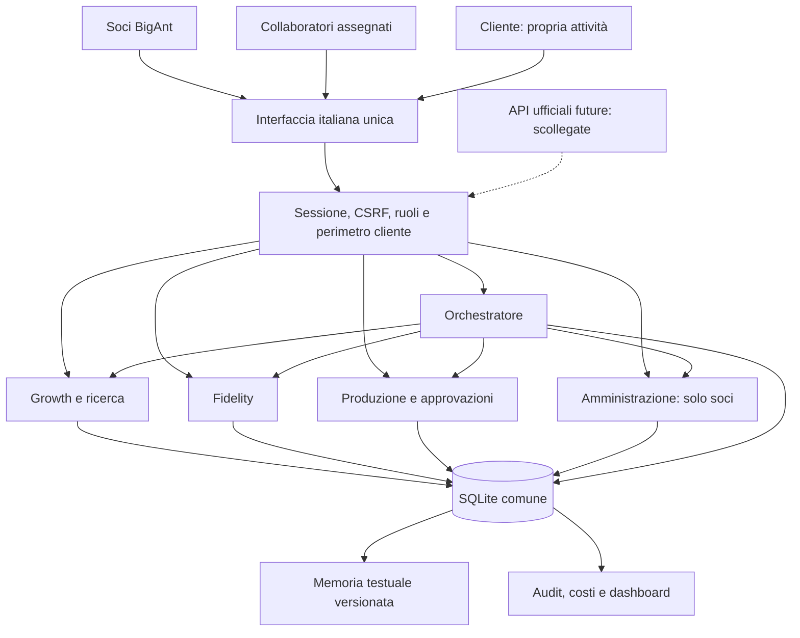

# Architettura BigAnt OS

8 ottobre 2026. Stato: **fondazione locale DEMO con moduli funzionanti e catalogo estensibile**. Nessun deploy o connettore reale. Il documento separa codice presente, adattamenti verificabili localmente e funzioni pianificate. Gli esiti finali dei test sono nel report notturno.

## Revisione dopo l’audit del brief

La [matrice di copertura](VERIFICA-COPERTURA-BRIEF.md) misura 30,2% di completamento funzionale, 14,9% oltre Growth/Fidelity. L’architettura prevista non è tutta implementata. La [struttura completa dell’agenzia](STRUTTURA-AGENZIA.md) aggiunge `src/agency/`: registro di contratti per 27 servizi, 32 specialisti, dieci moduli e tutte le sezioni dashboard; Marketing BigAnt dedicato e workspace filtrati per cliente/servizio. Le nove aree future hanno campi e sezioni espliciti, senza record o automazioni inventati.

Gli specialisti pianificati sono ora 21; le quattro definizioni dei moduli includono Fidelity. Le schede distinguono trigger implementati da eventi previsti. I nuovi endpoint sono di sola lettura, la mappa/marketing sono riservati ai soci e il cliente vede soltanto workspace dei servizi acquistati. Documenti e obiettivi rimangono “Solo struttura”. Nessuna nuova integrazione è stata attivata.

## 1. Un solo sistema, tre ambiti

BigAnt OS è una app interna per soci, collaboratori assegnati e titolari clienti. Un solo server, database, login e interfaccia ospitano:

1. Sciame: procedure specializzate, coda persistente, memoria, audit e budget.
2. Marketing/produzione: brief, task, contenuti, approvazioni e servizi.
3. Gestionale: acquisizione, contratti, cassa, scadenze, compensi, anomalie e direzione.

Growth e Fidelity non vengono incorporati come iframe o applicazioni secondarie. Le loro tabelle di dominio condividono chiavi client, utenti, approvazioni e registro OS. Gli originali online restano separati e intatti finché i soci non autorizzeranno una migrazione.

## 2. Componenti presenti nel repository

| Componente | Responsabilità effettiva | Limite |
|---|---|---|
| `server.js` | HTTP locale, sessione, autenticazione DEMO e password per utenti fittizi, Origin/CSRF, limiti richieste, routing, profili, clienti, approvazioni comuni, QR e worker ogni 2 secondi | Solo loopback; non un server di produzione attivabile con una variabile |
| `src/store.js` | SQLite condiviso, chiavi esterne, transazioni anche annidate, audit, dati comuni, controlli accesso | Una sola istanza prevista; niente database remoto configurato |
| `src/registry.js` | Servizi, reparti, agenti, integrazioni e moduli gestionali | Una voce pianificata non equivale a un'implementazione |
| `src/production.js` | Memoria, task, ore, contenuti, versioni, approvazioni, domanda/richiesta cliente | Nessuna pubblicazione remota o metrica marketing collegata |
| `src/orchestrator.js` | Calendari/eventi, code, tentativi, pausa, costi, specialisti locali, raccordo ai motori dei domini | Nessun modello generativo esterno; risultati da regole/fixture |
| `src/growth*.js` | CRM, ricerca/analisi DEMO, bozze, conversazioni simulate, consenso, appuntamenti locali, costi e conversione lead | Provider offline, indirizzi `.example`, nessun Gmail/Google reale |
| `src/fidelity*.js` | Programmi, iscritti, ledger, scanner, campagne, automazioni di preparazione, carte web e payload wallet | Nessuna firma o emissione wallet reale; coda esterna bloccata |
| `src/administration.js` | Prima nota immutabile, scadenze, documenti, controlli, quadrature, storni, tariffe/ore e margini parziali | Nessuna fiscalità presunta, banca, SDI o pagamento |
| `public/` | Dashboard italiana unica, ruoli e selettore attività, sezioni dei moduli, brand BigAnt | Contenuti e indicatori DEMO sempre distinguibili |
| `tests/` | Test di dominio e integrazione aggiunti nel collaudo | I test offline non provano provider o account reali |

Runtime dichiarato: Node `>=24.19.0 <25`, SQLite nativo. Dipendenze applicative fissate: **sharp 0.34.5**, per decodificare/sanificare loghi Fidelity, e **qrcode 1.5.4**, per generare codici QR. Non è corretto descrivere la versione finale come priva di qualsiasi pacchetto esterno. Nessun framework distribuito di agenti, broker o server aggiuntivo.

## 3. Dati comuni e confini

| Gruppo | Record | Vincolo |
|---|---|---|
| Identità | `os_users`, `os_sessions`, `os_assignments` | Sessione unica; ruolo dalla sessione, mai dal body |
| Clienti | `os_clients` | Cliente zero e attività clienti; servizi acquistati nel registro cliente |
| Lavoro | `os_tasks`, `os_contents` | Ogni record ha cliente; contenuti con versione/stato; minuti previsti/effettivi |
| Memoria | `os_memory`, `os_memory_versions` | Documento corrente per cliente/tipo e snapshot delle versioni, con contenuto, fonte e visibilità |
| Decisioni | `os_approvals`, `os_audit` | Entità/versione, autore/esito/motivo; visibilità internal/client/admin |
| Automazione | `os_jobs`, `os_schedules`, `os_costs`, `os_settings` | Identificativi idempotenti, lease, tentativi, tetto comune |
| Growth | `gr_*` | Potenziali clienti separati; conversione collega al cliente OS |
| Fidelity | `fi_*` | Consumatori/carte legati al cliente OS; token carta non è un ID pubblico innocuo |
| Amministrazione | `os_fin_*` | Ditta e conto separati dal cliente; importi in centesimi; solo soci |

`os_clients` non è una ditta emittente fattura. Un cliente può ricevere prestazioni da una delle due ditte secondo contratto; la ditta va conservata su ciascun documento/movimento. Nemmeno un iscritto Fidelity coincide automaticamente con un contatto commerciale Growth: consensi, finalità e dati sono distinti.

Le due ditte del prototipo hanno nomi **fittizi DEMO**. In fase autorizzata saranno sostituite dalle anagrafiche effettive delle ditte del brief, dopo conferma dei soci e del commercialista. Nessun documento contabile reale è nel repository.

## 4. Ruoli e permessi

| Funzione / dato | Socio `owner` | Collaboratore | Cliente |
|---|---|---|---|
| Clienti e produzione | Tutte le attività | Solo assegnate, task e bozze | Propria attività e percorsi autorizzati |
| Approvazioni contenuti | Decide per attività accessibili | Nessuna approvazione finale | Decide per propria attività |
| Memoria operativa | Per attività | Per attività assegnate, esclusa admin | Soltanto contenuti espressamente visibili al cliente |
| Growth, budget e regia agenti | Sì | No | No |
| Fidelity gestione | Tutte le attività | Operazioni al banco sulle assegnate, limiti specifici | Gestore della propria attività |
| Prima nota, compensi, prelievi, tariffe e margini | Sì | No | No |
| Registro generale | Con visibilità e perimetro | Senza admin e solo assegnazioni | Eventi client della propria attività |
| Account reali e azioni esterne | Scollegati nella demo | Scollegati | Scollegati |

I filtri devono esistere nel backend oltre che nel menu. Le carte pubbliche Fidelity e le prenotazioni Growth hanno percorsi locali dedicati, con token e dati ridotti; non devono diventare scorciatoie per leggere lo stato privato.

`os-orchestrator` è un'identità di servizio persistita in `os_users`, creata dal seed, distinta dai quattro profili DEMO interattivi. Non compare nell'elenco utenti gestibili, non può essere modificata dalla relativa API e il login con password la rifiuta. Il worker la usa anche per `Fidelity.tick`, così i controlli di esistenza, stato e ruolo del modulo rimangono attivi. Non è un accesso aggiuntivo da assegnare a una persona.

Il titolare di un'attività Fidelity originaria diventa **client OS**, non socio BigAnt. I dati economici grezzi non entrano nella memoria di social, marketing o direzione. Il controllo amministrativo accede al suo modulo; il Direttore Crescita attuale produce priorità operative e non legge righe di prima nota. Gli aggregati economici minimi per decisioni più evolute sono un'interfaccia futura da definire, non un'autorizzazione a condividere tutto.

## 5. Sciame presente e sciame futuro

Nel codice “agente implementato” significa procedura locale verificabile. Non significa che un modello AI stia ragionando, cercando sul web o lavorando in cloud.

| Agente | Stato reale | Legge → produce | Avvio / gate / costo |
|---|---|---|---|
| Direttore Crescita | Regole DEMO | Dati operativi selezionati → massimo 3 priorità | Manuale/calendario abilitato; decisione soci; €0 API |
| Marketing BigAnt | Regole DEMO | Contesto cliente zero → prossimo passo e vincoli portfolio | Manuale/calendario; pubblicazione bloccata; €0 |
| Account | Calcolo locale | Task e contenuti → scadenze/approvazioni e priorità | Manuale/evento/calendario; nessun messaggio; €0 |
| Social | Bozza deterministica | Cliente, memoria e feedback → contenuto DA APPROVARE | Solo servizio social attivo; gate umano; €0 |
| Qualità | Controlli limitati | Fonti/stati → segnalazioni | Non certifica qualità creativa o conformità legale; €0 |
| Reporter | Riepilogo locale | Task/contenuti → bozza di report nella memoria interna, con fonti e limiti dati | Nessun KPI esterno inventato né pubblicazione automatica al cliente; €0 |
| Amministrazione | Regole reali su fixture | Prima nota/documenti → anomalie, nessuna correzione autonoma | Socio risolve; €0 |
| Ricerca, Analista, Commerciale | Nel modulo Growth | Fixture, lead e messaggi → analisi/bozze/simulazioni | Motore di dominio e gate Growth; €0 |
| Video, ADV, SEO, sito, e-commerce, booking, reception, local, reputazione | Pianificati nel registro | SOP e schede disponibili; specialista autonomo non implementato | Nessun provider/costo attivato |

Calendari attualmente supportati dal motore centrale: giornaliero, lunedì, venerdì e primo del mese, **ore 09:00 Europe/Rome**, più eventi `content.ready`, `lead.created`, `client.created`. Gli orari più articolati del playbook sono una proposta operativa successiva; non sono già tutti configurabili dal motore.

Le pianificazioni seed sono disabilitate. Nell'avvio ordinario (`npm start`) il worker del server locale controlla automaticamente le code **ogni 2 secondi**; un blocco in memoria impedisce giri sovrapposti. La pausa centrale ferma sia gli specialisti sia i motori dei moduli. Il lavoro procede solo mentre il processo è acceso: non è un'automazione cloud.

Growth e Fidelity conservano code proprie per le loro regole, nello stesso database. Il giro comune richiama prima i motori dei domini e poi preleva al massimo un job centrale; non ci sono timer indipendenti nei moduli. La dashboard agenti mostra coda centrale, job di dominio ed eventuali errori dei moduli. Fidelity riceve l'identità tecnica persistita descritta sopra; le automazioni preparano soltanto bozze/campagne locali. Le esecuzioni centrali per attività disattivate vengono annullate e i calendari corrispondenti sospesi.

Gli specialisti centrali prenotano un costo, eseguono una transazione, registrano output/fonti/audit e chiudono il costo. Errori: attesa crescente e massimo tre tentativi; dopo serve verifica. Lease scadute permettono recupero del lavoro centrale. Il budget è condiviso; i dettagli specifici Growth non vanno sommati una seconda volta. Nella demo tutti i provider costano zero; l'uso di importi non nulli richiederà misurazione e riconciliazione col fornitore.

## 6. Memoria e contenuti

La memoria vive in documenti testuali con tipo/versione/fonte conservati nel database e esportabili in Markdown. `os_memory` contiene la revisione corrente; i trigger registrano snapshot in `os_memory_versions` all'inserimento e all'aggiornamento, senza sovrascrivere una versione già presente. Lo storico è immutabile: le API non espongono modifica o cancellazione e due trigger SQLite rifiutano anche `UPDATE` e `DELETE` diretti sui record. La lettura `GET /api/production/memory/history` è riservata al team autorizzato e omette memorie amministrative e memorie correnti diventate amministrative; la UI offre «Versioni».

Si legge SOP → scheda cliente → feedback. Il Reporter scrive una nuova bozza `internal`, e una revisione manuale torna interna: non ereditano automaticamente la visibilità cliente di un report precedente. Il rilascio del report al cliente richiede un percorso di approvazione e consegna da completare; nella demo la bozza resta al team. Non si recuperano credenziali o archivi clienti dal filesystem. Non esiste sincronizzazione Mac/Drive in produzione nella demo; la scelta evita una seconda copia da aggiornare manualmente.

Il flusso è IDEA → IN PRODUZIONE → DA APPROVARE → APPROVATO → pianificazione → PUBBLICATO → RIUTILIZZABILE. Ogni modifica a titolo/testo incrementa versione e rende obsolete le approvazioni precedenti. Un rifiuto richiede motivo e alimenta il feedback del cliente.

Aggiornamento FUN-062, 10 ottobre: [SOP dei contenuti](SOP-PUBBLICAZIONE-CONTENUTI.md). Decisione e pianificazione ricontrollano identità e permessi correnti, servizio attivo e corrispondenza di cliente, contenuto, versione, titolo e testo. Il calendario richiede inoltre una decisione datata di una persona ancora autorizzata. `os-orchestrator` prepara bozze ma non le approva, anche in DEMO. Il collaboratore assegnato può decidere soltanto sui post social; gli altri contenuti richiedono un socio. Gli stati successivi alla pianificazione restano non raggiungibili: il controllo dell’approvazione non sostituisce il futuro connettore e la sua autorizzazione.

La sola data di pianificazione è un dato interno. Connettore scollegato significa nessuna programmazione accettata da Postiz/social e nessuna pubblicazione: servono ricevuta/ID esterno e controllo successivo per questi stati. Il porting deve mantenere chiara questa distinzione anche se un nome di stato storico è conservato per compatibilità.

Growth e campagne Fidelity usano la coda `os_approvals`, ma la decisione viene inoltrata al modulo proprietario per aggiornare **insieme** stato del dominio e decisione. Non basta cambiare la riga di approvazione. Versioni vecchie e decisioni ripetute vengono respinte. L'abilitazione dei provider rimane un gate separato.

## 7. Schede dei 19 servizi e servizi aggiuntivi

Perimetro UI attuale: ogni servizio compare in **Catalogo**; quando acquistato può avere task/contenuti e apparire nella vista cliente. Dove è scritto “scheda/SOP” non esiste ancora un backend specializzato. Le SOP complete con ore, deliverable, KPI e rischi sono in [PLAYBOOK.md](PLAYBOOK.md).

Costo “€0 demo” indica nessuna chiamata esterna nella versione locale; non significa servizio gratuito da produrre. “Da quotare” è una dipendenza futura, non un acquisto approvato. Tutte le integrazioni nominate sono scollegate.

| # / ID | Dati input → output | Reparto/agente e permessi | Innesco / frontend / backend presente | Integrazione, costo e attivazione |
|---|---|---|---|---|
| 1 `presence` | Sedi, orari e fonti → incoerenze e bozze recensioni | Local/Reputazione; team assegnato, cliente su propri risultati | Controllo giornaliero proposto; Catalogo/cliente; scheda/SOP, task comuni | GBP/directory autorizzate; partner da quotare. Prima cliente zero e una sede |
| 2 `multisite` | Identificativi sedi/referenti → confronto e problemi per sede | Local/Account; isolamento per cliente | Cambio sede/mensile proposto; Catalogo; scheda/SOP | GBP e partner directory; costo per sede da verificare. Attivare con primo cliente multi-sede |
| 3 `reception` | FAQ, orari, escalation → richiesta/trasferimento e riepilogo | Reception/Account; dati minimi, socio su contratto | Chiamata futura; Catalogo; nessun centralino implementato | Partner voce, costo/minuto da quotare. Solo dopo prenotazioni testate |
| 4 `website` | Brief, pagine, asset → sito di prova e collaudo | Sito/Copy/QA; team assegnato, approvazione socio/cliente | Commessa; Lavori/Catalogo; task e memoria comuni | CMS/hosting autorizzati, costo progetto separato. Sviluppatore per integrazioni complesse |
| 5 `accessibility` | Percorsi/versione sito → audit e difetti verificati | QA/specialista; revisione umana | Rilascio/trimestre proposto; Catalogo; SOP | Strumenti di test e competenza specialistica; costo audit da stimare. Nessuna certificazione automatica |
| 6 `seo` | Sito/query/dati fonte → priorità e brief | SEO/Copy/QA; per cliente | Mensile proposto; Lavori/cliente; scheda e task | GA4/GSC in lettura futura; strumenti da quotare. Attivare dopo baseline |
| 7 `ecommerce` | SKU/prezzi/stock/condizioni → catalogo e ordini test | Partner tecnico/QA; accessi autorizzati | Commessa; Catalogo; nessun motore ordini | Piattaforma esistente, canone/commissioni separati. Partner dal primo caso |
| 8 `social-commerce` | Catalogo valido → feed e segnalazioni | Social/Catalogo; solo cliente assegnato | Aggiornamento feed futuro; Catalogo; SOP | API social, idoneità paese/account da verificare. Dopo e-commerce funzionante |
| 9 `booking` | Disponibilità/servizio → appuntamento locale | Account/Growth; socio e token locale limitato | Richiesta; Growth e pagina prenotazione; logica DEMO Growth | Calendar reale scollegato; €0 demo. Non ancora prodotto agenda universale clienti |
| 10 `ads` | Brief/mappa leve/tracking → piano e creatività | Raffaele/Ads/QA; socio autorizza budget/account | Brief e revisione periodica; Lavori/Catalogo; SOP e task | Google/Meta, budget media separato. Altri canali soltanto dopo competenza e SOP |
| 11 `display` | Target e proposta partner → piano e consuntivo | Planner/partner; decisione spesa soci | Commessa; Catalogo; segnaposto | Network terzi, preventivo separato. Non si replica rete proprietaria |
| 12 `social` | DNA/memoria/input → bozze, revisioni, calendario interno | Social locale; approva un socio o collaboratore assegnato | Manuale/evento/calendario; coda comune; prova umana della stessa versione verificata dal server | Connettore futuro; €0 agente demo, nessuna pubblicazione esterna. SOP-PUBBLICAZIONE-CONTENUTI |
| 13 `video` | Storyboard, diritti, brand → master/adattamenti | Video/art direction/QA; socio su rilascio | Commessa; Lavori/Catalogo; SOP/task, niente rendering agente | Strumenti creativi esistenti; produzione/licenze fuori budget OS. Foto isolate escluse dalla prima acquisizione |
| 14 `marketplace` | Eventuale richiesta canale → valutazione | Commerciale/soci | Solo valutazione; Catalogo; escluso | Nessun marketplace proprietario da costruire o attivare |
| 15 `tv` | Brief/budget/formati → spot e piano uscite | Video/partner media; doppio gate creatività/spesa | Commessa; Catalogo; SOP | Concessionaria/DOOH, costi separati. Attivare con domanda e margine |
| 16 `merch` | Quantità, logo, costo fornitore → bozza/preventivo | Design/fornitore; socio ordina | Richiesta esplicita; Catalogo; SOP | Fornitore, merci escluse dal budget OS. Fuori acquisizione automatica iniziale |
| 17 `apple-leasing` | Eventuale contratto interno → scadenza amministrativa | Soci/Amministrazione | Nessun agente commerciale; Catalogo escluso | Nessun prodotto da realizzare; costo solo se contratto separato autorizzato |
| 18 `verticals` | Componenti/capacità/claim → pacchetto e KPI | Direzione/QA/Account; soci e revisore competente | Revisione catalogo; Catalogo; SOP | Usa servizi già collaudati; sanità senza dati clinici. Listino dopo costo effettivo |
| 19 `audit` | URL/fonte pubblica → evidenze e prossimi passi | Ricerca/Analista/QA, soci | Lead o richiesta; Growth; analisi deterministica fixture | Ricerca futura autorizzata, €0 demo. Nessun audit reale presentato come verificato |
| Extra `branding` | Identità/pubblico → concept/manuale | Alfonso/design; gate concept e diritti | Commessa; Lavori/Catalogo; SOP/task | Figma/Canva/Adobe esistenti, costi lavoro separati |
| Extra `growth` | Lead/consenso → pipeline, bozze, incontri e cliente OS | Commerciale; solo soci | Manuale/coda dominio; pannello Growth; porting locale reale | Brave/OpenAI/Gmail/Calendar offline; €0 demo. Dettagli API-GROWTH |
| Extra `fidelity` | Programmi/iscritti/consensi → saldo, carta, campagne preparate | Account/gestore cliente; collaboratore limitato | Iscrizione/scansione/data/inattività; pannello e carta; porting locale reale | Wallet esterni scollegati, €0 demo; sharp per logo. Dettagli API-FIDELITY |
| Extra `local` | Scheda GBP/fonti → attività e report | Vincenzo/Local; assegnazioni cliente | Ricorrenza futura; Lavori/Catalogo; SOP/task | GBP scollegato. Base del servizio presence, non fonte duplicata |

Non si creano server o database per ciascuna riga. Il registro è la mappa dei servizi; i backend specializzati si aggiungono solo quando una SOP collaudata richiede regole che task/contenuti comuni non possono esprimere.

## 8. Gestionale: moduli e flussi

| Area | Presente | Da completare / gate |
|---|---|---|
| Anagrafiche | Clienti OS, controparti amministrative DEMO, utenti/assegnazioni, ditte/conti | Importazione fonti reali autorizzata |
| Commerciale e contratti | Pipeline Growth, conversione cliente, contratti con date/preavviso e servizio | Firma e preventivi completi non automatizzati |
| Documenti e incassi | Bozze gestionali, residui e abbinamento incasso | Software fiscale da identificare; niente SDI |
| Scadenziario | Compensi, prelievi concordati, hosting/domini/altro, rinnovi abbonamenti e contratti | Scadenze fiscali solo dopo conferma professionale |
| Prima nota | Centesimi interi, entità/conto, controparte/documento, idempotenza, saldi | Collegamento futuro in lettura a fogli/banca |
| Rettifiche | Contromovimento collegato, nuovo movimento atomico, note e documenti, periodo aperto | Nessuna riscrittura del passato o cambio ditta implicito |
| Quadratura | Confronto saldo calcolato/reale per conto e mese, chiusura con differenza zero | Chiusura generale e procedura migrazione da provare sui dati autorizzati |
| Anomalie | Regole deterministiche e gestione motivata degli stati | Statistica spese, Tracker reale e controlli non osservabili dichiarati mancanti |
| Ore e margini | Task, minuti previsti/effettivi, tariffe confermate e attribuzione univoca; stima/consuntivo separati | Costi comuni, competenza e utile fiscale non inventati |
| Compensi/prelievi | Obblighi, pagamenti e accordi distinti dai costi | Previdenza/ritenute/accantonamenti non calcolati senza conferma |
| Documenti/autorizzazioni | Riferimenti nei record, memoria e approvazioni | Repository documentale completo, firme e DPA operativi futuri |
| Direzione | Sei domande, priorità, stato operativo | Capacità disponibile da configurare; nessun sovraccarico inventato |

La lista anomalie ha fonte, priorità, importo, responsabile e nota. `detected` indica se la condizione è ancora rilevata e non coincide con la decisione `resolved` del socio. L'analisi non modifica movimenti. Le API e le formule precise sono in [API-AMMINISTRAZIONE.md](API-AMMINISTRAZIONE.md).

## 9. Dashboard interna e cliente

La UI condivisa offre Direzione, Amministrazione, Clienti, Lavori e contenuti, Growth, Fidelity, Sciame, Approvazioni, Registro, Catalogo, Collegamenti e Vista cliente, con navigazione filtrata per ruolo.

La panoramica del socio include un oggetto `agency` separato dalla selezione di un singolo cliente: lavori aperti e in ritardo, approvazioni, registro recente, numero di servizi per cliente e ultime priorità del Direttore. È restituito soltanto ai soci. I dati `tasks`, `contents`, `memory` e gli altri elenchi della singola attività mantengono invece il proprio perimetro. Collaboratori e clienti non ricevono l'aggregato centrale dell'agenzia né lo stato amministrativo.

La vista cliente deve rendere comprensibili panoramica, contatti, social, pubblicità, Google/local, reputazione, sito, contenuti da approvare, report/documenti e richieste all'agenzia. Le sezioni informative senza connettore mostrano **non collegato** e non generano KPI finti. Le metriche del database DEMO sono marcate tali. “Chiedi all'agenzia” produce un riepilogo locale dei task/contenuti e può aprire un task; non è un chatbot generativo collegato ai dati reali.

Le capacità possono arrivare prima via API e poi in UI. Il documento API identifica ciò che funziona nel backend; il report finale distingue ciò che è anche stato esercitato nell'interfaccia. Non dichiarare che un pulsante o un catalogo equivalgano a un servizio end-to-end.

Brand: logo BigAnt, arancione `#F26B21`, nero `#141413`, linguaggio italiano. Le app originali mantengono il proprio aspetto: nessuna variazione remota.

I QR Fidelity sono immagini PNG generate dal server Node con `qrcode`, senza servizio remoto: link locale alla tessera o all'iscrizione del programma. La tessera viene validata prima di generare il QR pubblico; il QR programma richiede sessione e accesso all'attività corretta. Il collaudo automatico verifica disponibilità, tipo PNG, isolamento e revoca. Non prova la lettura con una fotocamera fisica.

## 10. Integrazioni, costi e funzionamento futuro in cloud

Tutti i connettori del registro sono scollegati: Ads, Meta, GA4, Search Console, GBP, Postiz, Gmail, Calendar, Sheets, Drive, Trello, OpenAI, Brave, Wallet, PED, fatturazione e notifiche. Le API di configurazione segreti/attivazione reale sono bloccate nella demo. Non si importano credenziali esistenti.

Percorso futuro proposto: un connettore in sola lettura per volta; autorizzazione del titolare; permessi minimi; fonte/ultimo aggiornamento; dati non disponibili chiaramente indicati; revoca; test su due clienti isolati. Solo dopo si valutano azioni di scrittura con approvazione del payload/versione, limite costo, identificativo idempotente e riconciliazione degli esiti incerti.

Il cloud futuro resta una **decisione successiva**. La candidata economica è una sola istanza applicativa con volume persistente in regione UE, processo worker comune e backup verificato. SQLite richiede gestione coerente di singola istanza e concorrenza; se emergono necessità reali si migra verso un database separato tramite esportazione/versioni, senza riscrivere i domini. Non si attiva questa infrastruttura nella notte.

Tetto prova €50, hosting incluso come assunzione prudente. Quote iniziali centrali 3.500 centesimi fissi/riserva e 1.500 variabili; zero consumi provider nella demo. Il confronto di alternative/costi è in [CONFRONTO-MERCATO.md](CONFRONTO-MERCATO.md). Ore umane e strumenti creativi sono costi separati da misurare.

Prima di un rilascio reale servono autenticazione definitiva senza accessi DEMO, HTTPS, gestione segreti fuori repository, backup/ripristino, osservabilità, retention, accordi e ruoli confermati, collaudi con i provider. Il semplice riavvio del prototipo su Railway non costituisce tale fase.

## 11. Estensibilità e verifiche

La procedura concreta è [COME-AGGIUNGERE-UN-MODULO.md](COME-AGGIUNGERE-UN-MODULO.md). Un nuovo modulo deve utilizzare connessione, sessione, clienti, approvazioni, audit e budget comuni. Nessun login parallelo, filesystem credenziali, timer nascosto o invio al solo click di attivazione.

Ogni consegna va provata con isolamento clienti, rifiuto per ruolo, validazione importi/versioni, duplicati/retry e assenza di effetti esterni. Per un provider scollegato si verifica il blocco, non si sostituisce un successo fittizio all'esito. La migrazione funzione per funzione delle app originali rimane una verifica separata da questa architettura.

## Avanzamento della piattaforma — aggiornamento 10 ottobre 2026

`src/platform-progress.js` registra la capacità di consultare lo stato dell’installazione tramite `GET /api/workspace/progress`. Soci attivi soltanto, identità riletta, ambito piattaforma indipendente dal cliente selezionato. Aggrega metadati di custodia, agenti, autorizzazione Google, Growth, Wallet e backup senza avviare operazioni, aprire il vault o scrivere record. Risposta minima: 17 schede con perimetro, mancanze, fonte ed eventuale data dell’evidenza, più nove Fondamenta conservate. Nessun account, dato cliente o importo nella risposta.

Gli snapshot dedicati `growth.progress(user)` e `fidelity.progress(user)` riusano i controlli delle configurazioni correnti senza inizializzare workspace o impostazioni. Le API operative mantengono il comportamento precedente. Stati e limiti in [SOP Avanzamento](SOP-AVANZAMENTO.md); questa lettura non certifica i provider o il completamento del progetto.

## Calendario Growth — aggiornamento 10 ottobre 2026

`src/growth-calendar.js` separa la preparazione Calendar reale dal motore DEMO. Il contratto delle API e i controlli sono nella [SOP Calendar](SOP-GROWTH-CALENDAR.md). La nuova capacità comprende configurazione, controllo FreeBusy, prova alla casella verificata, conferma della ricezione, attivazione, link autorizzato per singolo contatto, prenotazione, riconciliazione e annullamento. OAuth conserva gli ambiti richiesti dal socio e tratta Calendar come consenso facoltativo aggiuntivo a Gmail.

Le prenotazioni usano intenzioni persistenti, payload immutabile, calendario originale, identificativo evento stabile e marcatura OS. Link monouso conservati come hash; transazioni e intervalli UTC per gli impegni locali sullo stesso calendario. Timeout o riavvio non autorizzano nuovi invii. Le verifiche remote confrontano i dati approvati; l’annullamento usa la versione remota dell’evento. Le note interne non escono dal CRM.

Il flag `BIGANT_GROWTH_CALENDAR_ENABLED` è spento per impostazione predefinita. Nessuna autorizzazione o collaudo reale è implicito nel codice. Le fasi Growth precedenti e il consenso Google restano prerequisiti delle nuove prenotazioni; una pausa degli invii non impedisce la verifica di un evento già registrato. La disponibilità può cambiare per azioni esterne all’OS fra la lettura e l’inserimento Google.

## Registro dei profili pubblici — aggiornamento 10 ottobre 2026

`src/profile-directory.js` registra la capacità di leggere e aggiornare i link pubblici per attività, dietro le API comuni di Workspace. Sei canali fissi, proprietario e cliente riletti dal database, scrittura solo dei soci e controllo della versione corrente. Lo storico append-only conserva ogni versione e l’audit comune registra soltanto metadati. Contratto e responsabilità nella [SOP Profili](SOP-PROFILI.md).

Il registro conserva URL e fonte dichiarati dal socio, senza chiamare servizi esterni. Non è un connettore e non trasforma il link in un account collegato. Metriche, sincronizzazione e recensioni restano assenti. Google Business Profile ospita il punto di raccolta delle recensioni future. La vista cliente definitiva attende il giro dedicato; l’API ne verifica già l’isolamento. [Prove e limiti](COLLAUDO-PROFILI.md).
